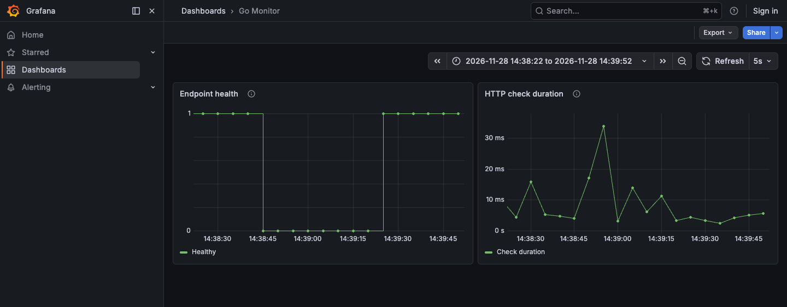

# Go Monitor

Go Monitor checks the health and response time of a single HTTP endpoint. This local demo uses Prometheus and Grafana to show what happens when a service fails and recovers.

## Start the demo

You need Git, Docker with Compose, and internet access to download the images on the first run. Docker builds the Go programs, so a separate Go installation is optional.

```sh
git clone https://github.com/crnly/go-monitor.git
cd go-monitor
docker compose up --build -d
```

Docker starts four services on your computer. The Go monitor checks the demo endpoint every five seconds and exposes the latest result at `/metrics`. Prometheus collects the metrics and evaluates the alert rule. Grafana loads the dashboard automatically and queries Prometheus with PromQL.

Allow a few seconds for the first measurement, then open the two local views. [Grafana dashboard](http://127.0.0.1:3000/d/go-monitor) · [Prometheus alerts](http://127.0.0.1:9090/alerts)

The published ports bind to `127.0.0.1` on the computer running Docker. Grafana allows local read-only access without a login, and the demo controls are local.

## Simulate an outage

Once Grafana shows a healthy check, switch the test service from HTTP 200 to 503.

```sh
curl -X POST http://127.0.0.1:8081/fail
```

The dashboard shows the check status switch from `1` to `0` while the duration panel keeps recording how quickly the service responds. The `EndpointUnavailable` alert goes from `pending` to `firing` when the failure condition has held for 30 seconds. Allow a few extra seconds for the check, scrape, and alert evaluations.

Restore HTTP 200 and watch the alert return to `inactive`.

```sh
curl -X POST http://127.0.0.1:8081/recover
```



## Check or stop the stack

`-d` runs the containers in the background, even after you close the terminal. Run these commands from the project directory.

```sh
docker compose ps
docker compose down
```

`ps` shows what is running. `down` stops the demo and frees its ports. Run the start command again when you want to use the demo.

## Run a single check or the Go tests

With Go 1.26.3 or later installed, run these commands from the project directory.

```sh
go run . https://example.com
go test ./...
```

The CLI prints the HTTP status, time to response headers, and whether the result was healthy. A final HTTP 2xx response counts as healthy. The client times out after five seconds. Tests use local HTTP servers to cover 200, 503, and timeout.

## Project structure

```text
go-monitor/
├── .dockerignore
├── .gitignore
├── Dockerfile                      # Builds the Go programs
├── README.md
├── compose.yaml                    # Connects the four services
├── go.mod
├── main.go                         # One-off HTTP check and CLI
├── main_test.go                    # HTTP status and timeout tests
├── monitor.go                      # Runs checks and serves /metrics
├── demo/
│   └── main.go                     # Switchable test endpoint
└── monitoring/
    ├── grafana/
    │   ├── dashboard.json          # Dashboard and its PromQL queries
    │   ├── dashboard.png           # Screenshot from the local demo
    │   └── provisioning/
    │       ├── dashboards/
    │       │   └── go-monitor.yml  # Loads the dashboard
    │       └── datasources/
    │           └── prometheus.yml  # Connects Grafana to Prometheus
    └── prometheus/
        ├── alerts.yml              # PromQL alert rule
        └── prometheus.yml          # Metric collection settings
```

To monitor a different endpoint, set `MONITOR_TARGET` to a URL reachable from the monitor container when starting Compose.
